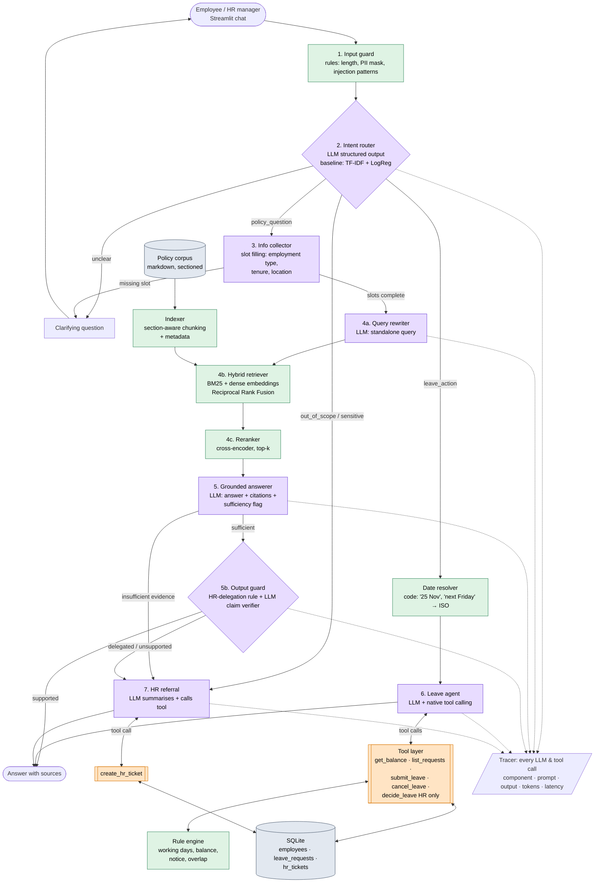

# Architecture — HR Assistant [confirmed]

## Data flow

**Legend.** 🟪 **LLM call** (OpenRouter API). 🟧 **Tool call** requested by the LLM via native function calling, the **only** path to the database. 🟩 Local code or local model (no API). ⬜ Data store.

**Database access rule (from the brief: "use a database… and access it via LLM only").** Every read or write to SQLite happens inside a tool that an LLM decided to call: the leave agent's tools and the HR referral's `create_hr_ticket`. The UI and the pipeline code never query the DB directly. (Eval scripts inspect the DB state after a run to score outcomes; they are not part of the application.)

## Components

| # | Component | Purpose | Input → Output | Model / tool calls | Eval |
|---|---|---|---|---|---|
| 1 | Input guard | Block injection attempts, mask PII before it reaches the LLM | raw text → clean text / block | none (rules) | red-team slice: block rate, false-block rate |
| 2 | Intent router | Pick the processing path | message + short history → `{intent, confidence}` | **LLM** (JSON schema); classical baseline for comparison | confusion matrix, macro-F1, MCC, recall(out_of_scope) |
| 3 | Info collector | Detect which facts a question depends on and ask for missing ones | question + employee profile → slots / clarifying question | **LLM** (JSON schema) | slot P/R/F1, clarification precision/recall |
| 4a | Query rewriter | Turn a conversational turn into a standalone search query | history + question → query | **LLM** | direct: standalone-ness and key-term preservation vs gold rewrites; ablation: Recall@5 with vs without rewriting |
| 4 | Indexer / chunker | Split policies into citable, structure-preserving chunks | markdown docs → chunks with `doc_id`, `§`, title, table rows kept intact | none (local code) | section integrity (every gold section maps to exactly one chunk, no table split) + chunking-variant ablation on Recall@5 |
| 4b | Hybrid retriever | Find candidate policy sections | query → top-20 chunks | BM25 + Sentence-Transformers (local) | Hit@k, Recall@k, MRR: BM25 vs dense vs hybrid |
| 4c | Reranker | Reorder candidates precisely | query + 20 chunks → top-5 | cross-encoder (local) | MRR / nDCG@5 before vs after |
| 5 | Grounded answerer | Answer only from evidence, cite sections, flag insufficiency | query + slots + top-5 → `{answer, citations[], sufficient}` | **LLM** (JSON schema) | correctness (judge), Faithfulness, citation accuracy |
| 5b | Output guard (iteration 3) | Stop answers that the policy delegates to HR or that rely on the policy being silent | answer + cited sections → pass / route to HR | code rule (5 delegating sections) + **LLM** verifier | controlled set: unsupported-claim recall, false-rejection rate; effect on referral P/R |
| — | Date resolver (iteration 3) | Turn natural date phrases into ISO dates for the agent | message → annotated message | code | unit tests; agent pass^3 on natural-date scenarios (holdout-2) |
| 6 | Leave agent | Run leave actions through tools | message + employee → tool calls → reply | **LLM** + **tools** | DB-state outcome, tool-sequence correctness, pass^k |
| 7 | HR referral | Escalate unsupported or sensitive questions | question → ticket summary + category → ticket ID | **LLM** + **tool** `create_hr_ticket` | referral precision/recall (decision); ticket category accuracy and summary completeness (content) |
| — | Rule engine | Deterministic leave decisions | request + DB state → approve / decline / pending_hr + reason | none (code) | unit-test suite covering every rule in `docs/crisp-dm.md` §1.4: pass rate (100% expected) |
| — | Tracer | Observability for the demo and debugging | every call → JSONL trace | none | coverage check: every LLM and tool call in the e2e suite appears in the trace with tokens and latency |
| E2E | Whole system | Extrinsic evaluation | scripted multi-turn scenarios → final reply + DB state | all | scenario success rate split by stop reason; cost and latency per completed task |

## Why not vanilla RAG
- **Routing** sends each message to the right source: documents → retrieval, live state → DB tools, unknown → human.
- **Clarification** happens before retrieval, because the policies are conditional.
- **Hybrid retrieval + reranking**, compared against single-method baselines.
- **Abstention → HR ticket** instead of hallucinating.
- **Agent with tools** over a database, with a deterministic rule engine and a confirmation gate for HR decisions.

## Walkthrough: one input through the system
*"How many vacation days can I carry over to next year?"* asked by a contractor:
1. **Guard** passes the text.
2. **Router** classifies it as `policy_question`.
3. **Collector** finds that carry-over depends on employment type. The type is already known from the profile (`contractor`), so no question is asked.
4. **Rewriter** produces "annual leave carry-over rules for contractors". **Retriever** runs BM25 + dense search and fuses the results with RRF. **Reranker** returns the top-5, with `leave-policy §1.2` (eligibility) and `§3.4` (carry-over) at the top.
5. **Answerer** replies: "Contractors are not covered by the annual leave policy, so carry-over does not apply [Leave Policy §1.2]", with `sufficient = true`.
6. The **Tracer** has logged 3 LLM calls with their tokens and latency. The UI shows the trace panel.
