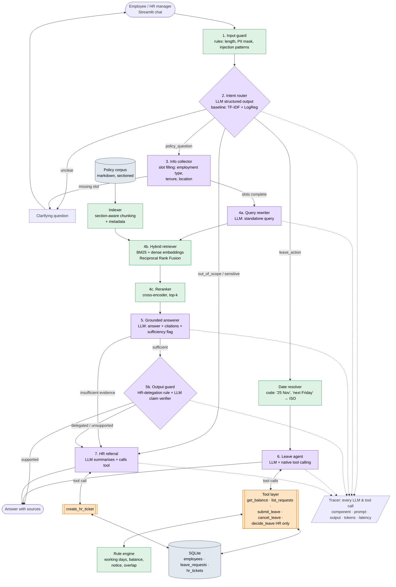

# HR Assistant for Lumora Tech: Report

**NLP course, Assignment 1: Build an NLP System.** Repository: https://github.com/KOTAYE/nlp-assignment-1

The assistant answers employee questions **only from company policy, citing the exact section**. It **asks for missing information** first, handles **leave requests through a database reachable only via LLM tool calls**, and **routes unsupported questions to HR**. Every component is evaluated. The work followed **CRISP-DM**: the full phase log and iteration log are in [`docs/crisp-dm.md`](crisp-dm.md).

---

## 1. Business understanding: scope

**Problem.** HR answers the same questions again and again (leave, sick notes, benefits, expenses, documents) and processes leave requests by hand.

**Users.**
- *Employees* ask policy questions and request, check and cancel leave.
- *HR managers* review requests the rules could not decide, through the same chat.

**Business logic kept in scope.**

| Capability | Rule |
|---|---|
| Policy Q&A | Answer only from the 9 Lumora Tech policies (98 sections), tailored to the employee's profile (full-time / part-time / contractor, office, probation), with a section citation in the reply text |
| Clarification | If the answer depends on a situational fact that is not known yet (illness duration, days abroad, expense type, document type), ask one question first |
| Leave requests | 4 types. **Annual:** 24 days/yr, pro-rated in the first year, ≤ 5 carry-over days until 31 March, notice 14 days (> 3 days) or 2 working days, ≥ 2 teammates off → HR. **Sick:** ≤ 3 days without a certificate, 10 paid days/yr. **Unpaid:** ≤ 20 days, always HR. **Special:** 3 days per event. Contractors are not covered. Decisions are made by a deterministic rule engine: *approved / declined / pending_hr* |
| Tracking | Every request is stored with its status. Employees can list and cancel; HR can list pending requests and approve or decline them (with explicit confirmation) |
| DB access | The SQLite DB is read and written **only inside tools that the LLM decides to call**. The UI never queries it |
| HR referral | Sensitive topics (salary, harassment reports, disputes…) and questions the policies do not support become an HR ticket (category + summary) via a tool call |

**Out of scope:** real authentication (a "log in as" selector stands in for SSO), payroll, notifications, document upload.
**Success criteria:** see the targets in `crisp-dm.md` §1.6 and the results in §5.

## 2. Data

- **Existing datasets were checked first** (`crisp-dm.md` §2):
  - Hugging Face: syncora HR QA (MIT), several small instruction sets;
  - GitHub: OpenGov HR manual (CC0);
  - Kaggle and IEEE DataPort: nothing suitable or accessible.
- No open dataset combined a policy corpus, questions with gold sections, conditional rules and leave records. So:
  - **Policy corpus:** synthetic, 9 documents, 98 numbered sections, ~4k words. The structure follows the OpenGov manual. It is designed for evaluation: conditional rules, cross-references, 4 tables, an outdated-rule trap, and explicit "handled by HR" sections.
  - **Employee/leave seed:** 30 fictional employees, 14 historical requests. Each leave rule has at least one triggering case.
  - **Eval data:** hand-labelled from the corpus. Realistic phrasings were adapted from syncora (labels re-assigned by hand). Datasets are split dev (~40%) / test (~60%); a **holdout** set was added after the first test run. Gold quality was checked automatically: every gold section exists, and every expected leave decision equals the rule engine's output.

| Dataset | Rows | Used for |
|---|---|---|
| `qa` | 62 (47 answerable + 15 must-refer) | retrieval, answerer, referral, oracle |
| `router` | 78 (5 intents) | router + classical baseline |
| `collector` | 44 | information collection |
| `rewriter` | 20 follow-ups | rewriter |
| `leave_agent` | 26 scenarios | agent trajectory evaluation |
| `guard` | 36 (18 attacks, 18 benign incl. PII) | input guard |
| `e2e` | 30 multi-turn conversations | end-to-end |
| `judge_calibration` | 19 controlled examples | judge reliability |
| `qa_holdout`, `agent_holdout` | 18 + 7 | unbiased estimate after iteration 2 |

## 3. System design

**Legend.** Purple = **LLM call** (OpenRouter, `openai/gpt-4o-mini`). Orange = **tool call** requested by the LLM, the only path to the DB. Green = local code or a local model. Grey = data.

| # | Component | Purpose | Input → output | Model / tool calls |
|---|---|---|---|---|
| 1 | Input guard | Block prompt injection, mask PII | text → allowed + masked text | rules |
| 2 | Router | Choose the path | message + history → intent (5 classes) | LLM (JSON schema) |
| 3 | Info collector | Find which facts the answer needs and ask for missing ones | question + profile → facts / clarifying question | LLM + regex fallback |
| 4a | Query rewriter | Make follow-ups standalone | history + question → query | LLM |
| 4 | Indexer | One citable chunk per `§`, with metadata, plus table-row units | markdown → chunks | local |
| 4b | Hybrid retriever | Candidate sections | query → top-20 | BM25 + `bge-small` dense, RRF |
| 4c | Reranker | Precise ordering | query + 20 → top-5 | cross-encoder (local) |
| 5 | Grounded answerer | Answer from evidence, cite, flag sufficiency | question + facts + top-5 → `{answer, citations, sufficient}` | LLM (JSON schema) |
| 5b | Output guard | Stop answers the policy delegates to HR or that rely on the policy being silent | answer + cited sections → pass / route to HR | code rule + LLM verifier |
| — | Date resolver | Natural date phrases → ISO dates for the agent | message → annotated message | code |
| 6 | Leave agent | Leave actions | message → tool calls → reply | LLM + tools |
| 7 | HR referral | Create a ticket | question → category + summary → ticket ID | LLM + tool |
| — | Rule engine | Leave decisions | request + DB state → status + reason + § | code |
| — | Tracer | Observability | every LLM/tool call → trace (UI + JSONL) | — |

**Walkthrough of one input:** *"Do I need a sick note?"* (Andrii, full-time, Lviv).
1. The guard passes it.
2. The router returns `policy_question`.
3. The collector finds that the answer depends on `illness_duration_days`, which is unknown, so the assistant asks *"How many working days have you been ill?"*.
4. The user replies *"4 days"*. The pipeline resumes the stored question.
5. The rewriter produces *"sick leave 4 days medical certificate required"*.
6. BM25 and dense rankings are fused with RRF into the top-20; the cross-encoder picks the top-5 with `sick-leave-policy §2.3` first.
7. The answerer replies *"More than 3 consecutive working days require a medical certificate; HR reviews the request [sick-leave-policy §2.3]"*, with `sufficient=true`.
8. The trace shows 4 LLM calls with tokens, cost and latency.

For a leave message the router returns `leave_action`. The agent calls `submit_leave_request`, whose implementation runs the rule engine and writes the request with its status.

**Why this is not vanilla RAG:** routing between three kinds of sources (documents, DB, people), clarification before retrieval, hybrid retrieval with reranking validated by ablations, explicit abstention with an HR ticket, and a tool-using agent over a database with deterministic business rules and a human confirmation gate.

## 4. Process: CRISP-DM and iterations

| Phase | What was done (details in `crisp-dm.md`) |
|---|---|
| Business understanding | Scope, leave rules, components, metric targets, all confirmed with the owner; compliance audit against the brief (traceability matrix) |
| Data understanding | Survey of open datasets; data strategy decided |
| Data preparation | Policy corpus, DB seed, gold datasets for every component with dev/test splits, automatic gold validation |
| Modeling | Rule engine (TDD, 41 tests); LLM wrapper with tracing; tools; retrieval stack; components; pipeline; UI |
| Evaluation | One eval script per component, calibrated judge, dev tuning → test → error analysis → iteration 2 → holdout |
| Deployment | Local Streamlit app, reset script, fixed business date for the demo, traces |

The iteration log in `crisp-dm.md` records every change with its metric **before → after**. The main loops:
1. **Smoke tests:**
   - the agent mis-applied the New-Year rule;
   - the collector over-asked;
   - HR referred to list positions instead of request IDs.
2. **Dev tuning:**
   - guard patterns;
   - few-shot examples for the collector;
   - rewriter prompt (the first LLM rewrite *lost* to simple concatenation: MRR 0.619 vs 0.938);
   - answerer abstention rule;
   - referral category definitions.
3. **Test, iteration 1:** clear dev overfitting (see §5.3).
4. **Iteration 2,** with general fixes driven by first-failing-stage analysis:
   - table-row index units (Docling idea);
   - an answerer sufficiency rule in both directions;
   - a calendar for the agent;
   - narrower collector scope;
   - code-guaranteed sources in the reply.
5. **Holdout,** written *before* the iteration-2 fixes (see the git history), to keep an unbiased estimate.
6. **Iteration 3:** a new **holdout-2** focused on the remaining weak spots (answer vs refer, natural dates) was written and committed first, and the iteration-2 system was measured on it as a baseline. Only then were the planned fixes applied:
   - an output guard: a code rule for sections that delegate to HR plus an LLM claim verifier (the Ethics lecture's "hallucination guard");
   - code-based date resolution for the agent;
   - a general router rule.
7. **Regression check:** iteration 3 introduced a date-context regression; it was caught on test, fixed with a unit test, and re-measured.

## 5. Evaluation

Every component is evaluated (brief: *"evaluation is required for every component"*). Full auto-generated tables, including dev results, per-class reports and error lists: [`docs/eval-results.md`](eval-results.md). Raw per-row results: `evals/results/`.

### 5.1 Why these metrics

The same principle applies to every component: **what can be checked in code is checked in code**; an LLM judge is used only where meaning matters (AI Agents lecture: "assertions beat judges"). Every metric below answers a business question from §1.6.

| Component | Metric(s) | Why this metric (and not another) | High vs low score means |
|---|---|---|---|
| Rule engine | unit-test pass rate over every rule in §1.4 | The rules are deterministic, so a probabilistic metric would hide bugs. Any failure is a wrong leave decision. | 100% is expected; anything less is a bug |
| Input guard | attack **recall** (block rate), **false-block rate**, PII masking accuracy | Errors cost differently: a missed attack is a security risk, while a false block annoys a real employee. A single accuracy would mix them (Evaluation lecture: precision/recall for asymmetric errors). | Low recall = attacks reach the LLM; high false-block rate = unusable |
| Indexer / chunker | section integrity (1 chunk per §, tables intact, metadata) + chunking ablation on Hit@5 / MRR | Citations need exactly one chunk per section ID. The ablation shows whether structure-aware chunking actually helps retrieval (RAG lecture: chunking strategies). | Integrity failures break citations; low MRR = evidence ranked too low |
| Router | **macro-F1**, **MCC**, per-class P/R, confusion matrix, **recall(hr_referral)**; vs TF-IDF+LogReg baseline | 5 imbalanced classes, so macro-F1 weights rare classes equally and MCC is robust to imbalance (Evaluation lecture). Recall on hr_referral is the costly error (a sensitive case answered by a bot). The baseline shows what the LLM adds. | Low hr_referral recall = sensitive cases are not escalated |
| Info collector | situational-fact **P/R/F1**, value-extraction accuracy, clarification **P/R** ("asked iff needed") | The brief requires metrics for *information collection*. Fact recall = asking for what matters; precision = not over-asking. Clarification precision/recall separates "annoying" from "answering without the needed facts". | Low precision = needless questions; low recall = answers that ignore the user's situation |
| Query rewriter | key-term coverage + **retrieval ablation** (raw follow-up vs concat baseline vs LLM rewrite: Hit@5, MRR) | A rewrite has no single gold string. Its value is whether it makes retrieval work for follow-ups, so it is measured through the downstream metric (extrinsic) plus a cheap intrinsic check. | Lower MRR than the baseline = the rewriter adds noise |
| Retrieval | **Hit@k, Recall@k, MRR@10, nDCG@5** vs gold section IDs, for BM25 / dense / hybrid / +reranker | The brief requires *retrieval success*. Gold section IDs make it deterministic (no judge). Hit@5 = is the evidence available to the answerer; MRR/nDCG = is it ranked first, which matters because the context is short (IR lecture). | Hit@5 < 1 = the answerer cannot be right; low MRR = a weak reranking |
| Answerer | **correctness** (4-level judge vs gold answer, calibrated), **faithfulness** (supported claims / all claims, RAGAS definition), **citation hit rate** | The brief requires *answer correctness* and *source support*. Correctness needs semantics, so a judge is used, with BLEU/ROUGE rejected because paraphrases are valid (Evaluation lecture). Faithfulness catches hallucinations even when the answer happens to be right. Citation hit is deterministic. | Contradictions = wrong policy information (worst case); faithfulness < 1 = unsupported claims |
| Oracle answerer | the same metrics with gold context | Separates generation errors from retrieval errors ("measure retrieval and generation separately"). | A gap between oracle and pipeline = retrieval loses evidence |
| HR referral | referral **precision / recall / F1** + ticket category accuracy | The brief requires *correct referral to HR*. Recall matters more: a confident wrong answer is worse than an extra ticket. Precision guards against "refer everything". | Low recall = hallucinated answers; low precision = useless assistant |
| Leave agent | trajectory layers: **outcome** (final DB state), **process** (required tools), **safety** (no forbidden tools / writes), **communication**; efficiency (steps, tokens, cost); **pass^3** | An agent can produce the right answer through a wrong process, or a fluent reply with a wrong DB state (AI Agents lecture: evaluate the trajectory). pass^k measures consistency, because LLM runs differ even at temperature 0. | Low pass^3 = unreliable in production even if pass@1 looks fine |
| Judge | agreement with **controlled examples** (exact level, pass/fail accuracy, contradiction recall) | "We need a benchmark for the judge" (Evaluation lecture). Correctness numbers are trustworthy only if the judge separates correct, partial and contradicting answers. | Low contradiction recall = the judge would hide wrong answers |
| End-to-end | scenario success rate (multi-turn, automatic checks), per-check pass rates, tracer coverage, cost and latency per conversation | Extrinsic evaluation: do the components work together in real conversations (clarification turns, follow-ups, HR approval flow)? | Component metrics can be high while hand-offs fail; this catches it |

### 5.2 Setup
- **Splits and how each was used:**
  - prompts and parameters were tuned on **dev**;
  - **test** was used first to measure iteration 1;
  - **holdout** was written before the iteration-2 fixes;
  - **holdout-2** (boundary cases: answer vs refer, natural dates) was written before the iteration-3 fixes and first used to measure the *unchanged* iteration-2 system as a baseline.
  - The final system is therefore estimated without bias on **holdout-2**. Earlier sets were seen during development and are reported for completeness.
- **Business date** fixed at 2026-11-12. Every result file stores the model, judge, prompt versions, date and git commit. **All tables are generated from the results files** in [`docs/eval-results.md`](eval-results.md) (`python -m evals.summarize`); the numbers below are copied from there.
- **Models:** generator `openai/gpt-4o-mini`; judge `google/gemini-2.5-flash`, a different family to avoid self-preference.
- **Cost:** the whole development, including all eval runs of three iterations, cost under $0.5. One question costs ≈ $0.0006 and takes ≈ 5–6 s, which includes the output-guard call.

### 5.3 Results for the metrics required by the brief (final system, iteration 3)

| Brief metric | How measured | Test | Holdout | **Holdout-2 (unbiased)** | Target (§1.6) |
|---|---|---|---|---|---|
| **Information collection** | collector situational-fact F1 / clarification accuracy | 1.000 / 1.000 | — | — | ≥ 0.90 / ≥ 0.85 |
| **Retrieval success** | Hit@5 / MRR@10 (hybrid + rerank); context recall@5 inside the pipeline | 1.000 / 0.925; 0.929 | 0.929 | 0.917 | ≥ 0.90 / ≥ 0.75 |
| **Answer correctness** | judge pass rate (fully or mostly right) over all answerable questions; contradiction rate | 0.893; 0.000 | 0.929; 0.000 | **0.917; 0.000** | ≥ 0.85 |
| **Source support** | faithfulness (supported claims / claims); citation hit rate | 1.000; 1.000 | 0.923; 1.000 | **1.000; 1.000** | ≥ 0.90; ≥ 0.90 |
| **Correct referral to HR** | precision / recall / F1 of "routed to HR" | 0.800 / 0.889 / 0.842 | 1.000 / 0.750 / 0.857 | **0.900 / 0.900 / 0.900** | ≥ 0.85 / ≥ 0.95 |

All targets are met on holdout-2 except **referral recall** (0.90 vs ≥ 0.95, one missed case out of 10, see §5.5). Referral precision (0.90) is above target.

### 5.4 Results per component

| Component | Key result (test unless noted) | Reading |
|---|---|---|
| Rule engine | 41/41 tests pass | The first run found a real bug (phantom carry-over from untracked 2025): 40 → 41 |
| Input guard | attack block rate **0.70**, false-block rate **0.00**, PII masking **1.00** (dev after tuning: 1.00 / 0.00 / 1.00) | High precision, limited recall: the regexes generalise poorly to unseen phrasings (leetspeak "Ign0re", role-play "let's play a game", "repeat the text above"). These test misses were seen in an early combined run and deliberately **not** patched, so test stays honest |
| Indexer | 98 sections → 98 chunks, tables intact, metadata present. Ablation (BM25): section-aware **MRR 0.850 / Hit@1 0.787** vs fixed 120-word windows **0.416 / 0.128** | Structure-aware chunking roughly doubles MRR. Fixed windows cut sections and mix their IDs |
| Router | LLM: accuracy **0.978**, macro-F1 **0.981**, MCC **0.973**, recall(hr_referral) **0.889**. TF-IDF + LogReg baseline (trained on 32 dev rows): 0.391 / 0.275 / 0.201 / 0.222 | The LLM wins by a wide margin with few labels. Its one test error ("coworker breaking the law" → policy_question) is a borderline case between reporting and asking how to report |
| Info collector | facts P/R/F1 **1.0/1.0/1.0**, value extraction **1.0**, clarification P/R **1.0/1.0** (6 asks, 19 non-asks) | Dev went 0.72 → 1.0 F1 after few-shot examples. The test set is small (25 rows), so 1.0 means "no observed errors". One unnecessary clarification appeared in the holdout pipeline run |
| Query rewriter | key-term coverage **1.0**. Retrieval on follow-ups (MRR@10): raw **0.413**, concat-previous-turn **0.819**, LLM rewrite **0.917** | v1 of the rewriter *lost* to concatenation on dev (0.619 vs 0.938) because it added noise. v2 restricted it to topic words and wins on test |
| Retrieval | Hit@5 / MRR@10: BM25 0.929 / 0.825 · dense 0.964 / 0.829 · hybrid RRF 0.964 / 0.876 · **+ reranker 1.000 / 0.925** | Each stage adds value: RRF fixes ranking where either retriever alone fails; the reranker puts the gold section first more often. Table-row units (iteration 2) make values hidden in tables retrievable |
| Answerer (oracle context) | answer rate with gold sections: iteration 1 **0.714** → iteration 2 **1.000**; correctness 1.000 | Isolates generation: iteration 1 abstained too often even with perfect evidence |
| Output guard (iteration 3) | controlled set: unsupported claims caught **0.889** (8/9), precision **1.000**, false-rejection rate **0.000** | It never blocks a supported answer. Its one miss ("birthdays are not company days off" with the holiday table as evidence) is a plausible reading of an exhaustive list. The 5 delegating sections are detected in code (unit test) |
| HR referral | P/R/F1: test 0.800/0.889/0.842, holdout 1.000/0.750/0.857, **holdout-2 0.900/0.900/0.900**; ticket category accuracy 0.875 / 1.000 / 0.778 | See §5.5 |
| Date resolver (iteration 3) | unit tests on natural phrases; effect: agent pass^3 on natural-date scenarios (holdout-2) **0.333 → 1.000** | LLMs mis-compute weekdays and years; code resolves them |
| Leave agent | pass^3 **1.000** on dev, test, holdout and holdout-2 (outcome, process, **safety** and communication all 1.000), 2.1 steps and $0.0003 per task on test | No forbidden tool was ever called, and no permission or confirmation was bypassed |
| Judge | controlled examples: exact level **0.947**, pass/fail accuracy **1.000**, contradiction recall **1.000** | The judge can be trusted to separate correct, partial and wrong answers |
| End-to-end | test success **0.889** (16/18), tracer coverage **1.000**, $0.0006 per conversation | All clarification, follow-up, leave, HR, guard and small-talk scenarios pass except the 2 failures in §5.5 |

### 5.5 Why the scores are not higher, and what would fix them

Errors are classified by the **first stage that loses the answer** (RAG lecture). Remaining errors in the final system:

1. **Router edge cases** (holdout-2, test). "Will my manager find out that I see the company psychologist?" is sent straight to HR (privacy plus manager reads as sensitive), although `benefits-policy §5.2` answers it. "My mother is in hospital, can I take paid days off?" goes to the leave agent (it sounds like an action) instead of HR. "Can I cancel a vacation I booked?" is ambiguous between rule and action.
   - *Next:* when the router's confidence is low, run both the policy path and the referral path and let the output guard decide; add more contrastive router examples.
2. **Silence-based answers still slip through** (test: "home internet"). The answerer says office-based employees are not eligible for remote allowances, which is true, and the verifier accepts it as supported because it applies a stated rule. The question, though, was about a cost the policies never mention.
   - *Next:* add a verifier check that the answer addresses the asked item itself (not a neighbouring rule).
3. **Over-referral after the output guard** (e2e: "three weeks in Croatia" → HR). `remote-work-policy §3.2` (longer stays, "decided by HR individually") was cited together with §3.1, so the code rule triggered although §3.1 answers a 21-day stay.
   - *Next:* apply the delegation rule only when the delegating section is the one the answer relies on (e.g. the top citation or a verifier-identified source).
4. **Guard recall 0.70.** Rules cannot cover paraphrased attacks. *Next:* a small learned injection classifier. Its impact is already limited by defence in depth: HR tools are not offered to employees, decisions need confirmation, and DB writes go only through validated tools.
5. **Small eval sets.** With 9–10 referral cases per set, one error moves recall by about 0.1. Metrics are point estimates. Three independent sets (test, holdout, holdout-2) agree in direction, which makes the improvement credible.

### 5.6 Iteration comparison

| metric | iter 1 · test | iter 2 · test | iter 3 · test | iter 2 · holdout | iter 3 · holdout | iter 2 · holdout-2 | **iter 3 · holdout-2** |
|---|---|---|---|---|---|---|---|
| Answer correctness (pass rate) | 0.786 | 0.857 | 0.893 | 0.857 | 0.929 | 0.833 | **0.917** |
| Faithfulness | 0.986 | 1.000 | 1.000 | 0.958 | 0.923 | 0.975 | **1.000** |
| Citation hit rate | 0.917 | 1.000 | 1.000 | 1.000 | 1.000 | 1.000 | **1.000** |
| HR referral precision | 0.700 | 0.667 | 0.800 | 0.750 | 1.000 | 0.818 | **0.900** |
| HR referral recall | 0.778 | 0.667 | 0.889 | 0.750 | 0.750 | 0.900 | **0.900** |
| Oracle answer rate | 0.714 | 1.000 | 1.000 | — | 1.000 | — | — |
| Leave agent pass^3 | 0.800 | 0.933 | 1.000 | 0.857 | 1.000 | 0.333 | **1.000** |
| E2E scenario success | 0.722 | 0.833 | 0.889 | — | — | — | — |

**Reading the table:**
- **Iteration 1 → 2.** Test showed dev overfitting. Fixing over-abstention (oracle answer rate 0.714 → 1.0) and table retrieval raised correctness, but referral recall fell: the answerer now answered some cases it should refer.
- **Iteration 2 → 3.** The output guard (code delegation rule + LLM claim verifier) restored referral quality while keeping the gains. The date resolver fixed the agent's calendar errors.
- **Effect on unseen data.** On **holdout-2**, written before iteration 3 and run against both versions, correctness went 0.833 → 0.917, referral precision 0.818 → 0.900, faithfulness 0.975 → 1.000, and agent pass^3 0.333 → 1.000. This is the cleanest evidence that the changes generalise.
- **Regression caught and fixed.** One regression was introduced by iteration 3 and caught on test: in a multi-turn dialogue a bare "the 14th" was resolved to November although the user had said December. It was fixed by using months named earlier in the conversation, with a unit test; agent pass^3 on test went 0.867 → 1.000.

## 6. AI coding assistant: how it was managed

- **`CLAUDE.md` (agent rules file):**
  - the **assignment brief has the highest priority**, with a traceability matrix (`docs/requirements-traceability.md`) updated before closing any phase, and the hard constraints listed explicitly;
  - **CRISP-DM is mandatory**: every task names its phase and ends with a phase-log and iteration-log update;
  - code conventions: one LLM wrapper with tracing, versioned prompt files, Pydantic structured outputs, DB only through tools, configuration only from `.env`;
  - evaluation rules: "assertions beat judges", dev/test split, first-failing-stage analysis, *never write a number that is not in a results file*;
  - git rules.
- **Skills** (`.claude/skills/`):
  - `crisp-dm-step` (phase entry and exit);
  - `add-component` (definition-of-done checklist: schema, prompt, tracing, tests, eval, baseline, docs);
  - `build-eval-dataset` (coverage of hard cases, splits, data card);
  - `run-evals` (metrics, calibration, interpretation).
- **Context management:**
  - the course lectures were condensed once into `docs/course-notes.md` and never loaded whole;
  - datasets were sampled, not dumped;
  - results are summarised by `evals/summarize.py`.
- **Quality gates:** `ruff` (lint + format), `pytest` (58 tests), eval results stored with prompt versions, model and git commit.
- **What the rules caught or prevented:**
  - a component writing to the DB without the LLM (fixed after the compliance audit);
  - a test-set example about to leak into a prompt;
  - a wrong gold label (#9 vs #10);
  - optimistic dev numbers, which were reported as such, with a holdout added.

## 7. Limitations and next steps

- Router edge cases (privacy questions read as sensitive; "can I take days off to care for…" read as an action) and silence-based answers that apply a neighbouring rule remain. See §5.5 for the next fixes (dual-path on low router confidence; a verifier check that the answer addresses the asked item).
- The guard is rule-based. It does not generalise to new attack phrasings, so a learned classifier is the next step. Defence in depth already limits the impact: tools enforce permissions, and HR decisions need confirmation.
- The eval sets are small (tens of rows per component), so differences of one or two rows matter. The next step is more data, including real employee phrasing.
- The synthetic corpus is cleaner than real handbooks (no scanned PDFs, no conflicting versions across documents).
- LLM non-determinism exists even at temperature 0. It is measured with pass^k; production would need retries or self-consistency for critical paths.
